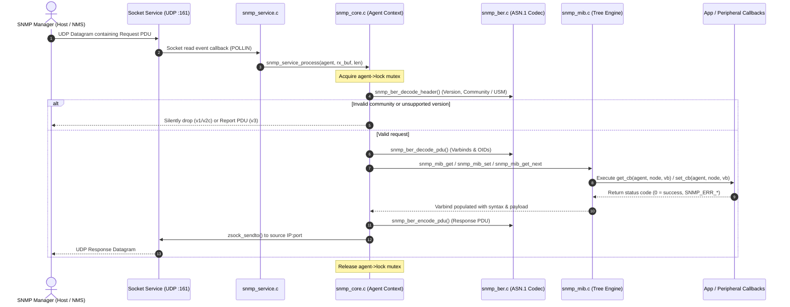

# SNMP Agent Architecture and Internals

This document details the internal architecture of the `zephyr-snmp` subsystem, its core design principles for resource-constrained microcontrollers, and the end-to-end lifecycle of an SNMP packet.

---

## 1. Design Principles

1. **Zero Dynamic Allocation (`malloc` = 0)**:
   - All operational memory (PDU structures, receive and transmit buffers, MIB nodes, and varbind queues) is statically allocated or embedded directly in the agent instance structure (`struct snmp_agent`).
   - Completely eliminates heap fragmentation in long-running embedded systems operating continuously for months or years.
2. **Re-entrant Multi-Instance Concurrency**:
   - Multiple independent SNMP agents can coexist concurrently within the same firmware image (e.g., dual-agent setups on different network interfaces or port numbers).
   - Each agent encapsulates its own state, MIB tree, network buffers, scratch space, and mutex (`agent->lock`).
   - Internal state contains zero mutable globals (verified mechanically via symbol audits).
3. **Scratch Space Memory Optimization**:
   - Memory-intensive operations (such as Two-Phase Commit SET state tracking and GETBULK repeaters) share an instance-embedded `scratch` union (`inst->scratch`).
   - This architectural decision reduces stack frame requirements from **9.8 KiB down to 52 bytes**, preventing stack overflow crashes in Zephyr cooperative or preemptive thread contexts.
4. **Native Zephyr Socket Service Integration**:
   - The transport layer binds to Zephyr's asynchronous `net_socket_service` infrastructure, eliminating dedicated thread overhead per open socket while supporting both IPv4 and IPv6 dual-stack polling.

---

## 2. Request and Response Pipeline



---

## 3. Core Subsystems

### A. Network Transport Layer (`src/snmp_service.c`)
- Uses Zephyr's `NET_SOCKET_SERVICE_SYNC_DEFINE_STATIC` to register socket file descriptors in the OS poll set (`zsock_pollfd`).
- Supports dual-stack **IPv4** (`AF_INET`) and **IPv6** (`AF_INET6`), binding each agent instance to its configured port (`cfg->port`, default 161).
- **ZVFS Polling Budget Requirement**: When running multiple instances, Zephyr's Virtual File System poll descriptor limit must be configured to accommodate all sockets:
  $$\text{CONFIG\_ZVFS\_POLL\_MAX} \ge \text{CONFIG\_SNMP\_MAX\_INSTANCES} \times \text{SNMP\_SVC\_FDS} + 1$$
  *(where $\text{SNMP\_SVC\_FDS} = 2$ when IPv6 is enabled, and $1$ for IPv4-only).* A `BUILD_ASSERT` enforces this constraint at compile time.
- Integrated **Token Bucket Rate Limiter** (`CONFIG_SNMP_RATE_LIMIT=y`) safeguards CPU resources against UDP broadcast storms and denial-of-service floods.

### B. ASN.1 BER Codec (`src/snmp_ber.c`)
The encoder and decoder operate directly over contiguous byte buffers with zero heap allocation:
- **ASN.1 Tags**:
  - Primitive: `INTEGER` (0x02), `OCTET STRING` (0x04), `NULL` (0x05), `OBJECT IDENTIFIER` (0x06).
  - Structured: `SEQUENCE` (0x30).
  - SNMP Application Types: `IpAddress` (0x40), `Counter32` (0x41), `Gauge32` (0x42), `TimeTicks` (0x43), `Opaque` (0x44), `Counter64` (0x46).
  - PDU Types: `GetRequest` (0xA0), `GetNextRequest` (0xA1), `GetResponse` (0xA2), `SetRequest` (0xA3), `Trap-v1` (0xA4), `GetBulkRequest` (0xA5), `InformRequest` (0xA6), `SNMPv2-Trap` (0xA7), `Report` (0xA8).
- **BER Length Processing**: Robust support for both short-form (< 128 bytes) and long-form (1 to 4 length octets).

### C. MIB Tree Engine (`src/snmp_mib.c`)
- Each agent maintains its registered scalar nodes in its instance array `agent->mib_nodes[CONFIG_SNMP_MAX_MIB_NODES]`.
- Nodes are sorted lexicographically by OID at registration time (`snmp_mib_register`, `snmp_mib_register_nodes`) using insertion sort, guaranteeing that **GETNEXT** and **GETBULK** lookups operate in $O(\log N)$ or fast linear scanning without dynamic graph traversal.
- Supports dynamic multi-column tables (`struct snmp_mib_table`) with index chaining.

### D. Scratch Space Memory Union
To eliminate massive stack frames during complex multi-varbind transactions, `struct snmp_agent` embeds a shared mutual-exclusion scratch union:
```c
union snmp_agent_scratch {
    struct snmp_set_tx_item tx_items[CONFIG_SNMP_MAX_VARBINDS];
    struct snmp_bulk_scratch bulk;
};
```
Because SET transactions and GETBULK requests are mutually exclusive under `agent->lock`, sharing this memory cuts the execution stack frame from **9.8 KiB down to 52 bytes**.

### E. Traps and Notifications (`src/snmp_trap.c`)
- Manages an array of up to `CONFIG_SNMP_TRAP_DEST_COUNT` remote NMS endpoints (IPv4/IPv6 address and UDP port).
- Dispatches standard enterprise traps (e.g. `snmp_trap_send_coldstart()`) as well as custom event traps with arbitrary varbind lists.
- Supports RFC 1157 SNMPv1 traps and RFC 3416 SNMPv2c traps.

---

## 4. Key Data Structures

### Scalar MIB Node Definition
```c
struct snmp_mib_node {
    struct snmp_oid oid;            /* Hierarchical unique Object Identifier */
    uint8_t type;                   /* ASN.1 tag (e.g. ASN1_TAG_INTEGER) */
    snmp_mib_get_cb_t get_cb;       /* Handler invoked on GET / GETNEXT */
    snmp_mib_set_cb_t set_cb;       /* Handler invoked on simple SET (or NULL) */
    snmp_mib_set_tx_cb_t set_tx_cb; /* Handler invoked on 2PC transactional SET (or NULL) */
    void *user_data;                /* Application-owned context pointer */
};
```

> [!NOTE]
> **Access Level**: The access level (Read-Only vs. Read-Write) is defined by whether `set_cb` and `set_tx_cb` are `NULL` (Read-Only) or implemented (Read-Write).

> [!WARNING]
> **User Data Invariant**: `node->user_data` and `row->user_data` must point **only** to application-managed memory or static constants. They must **never** point to `struct snmp_agent` or any field within it.

### Dynamic MIB Table Definition
```c
struct snmp_mib_table {
    struct snmp_oid table_oid;
    uint8_t column_cnt;
    const uint8_t *column_subids;
    const uint8_t *column_types;
    snmp_table_get_cb_t *get_cbs;
    snmp_table_set_cb_t *set_cbs;
    struct snmp_table_row *rows;
    void *user_data;
};
```

### Table Row Definition
```c
struct snmp_table_row {
    uint32_t index;                    /* Legacy single index (backward compatible) */
    struct snmp_table_index index_oid; /* Generalized / Compound index suffix */
    struct snmp_table_row *next;
    void *user_data;
};
```

### Agent Instance Structure (`struct snmp_agent`)
The agent instance structure encapsulates all state required for an independent agent:
- Mutex lock (`struct k_mutex lock`)
- Configuration copy (`struct snmp_agent_cfg cfg`)
- Receive and transmit buffers (`uint8_t rx_buf[...]`, `uint8_t tx_buf[...]`)
- Current parsed PDU (`struct snmp_pdu current_pdu`)
- Scratch space union (`union snmp_agent_scratch scratch`)
- MIB scalar node array (`struct snmp_mib_node mib_nodes[...]`) and count
- Table array (`struct snmp_mib_table tables[...]`) and count
- MIB-II interface cache (`struct snmp_mib2_if_row if_rows[...]`)
- Protocol statistics counters (`struct snmp_agent_counters counters`)
- SNMPv3 cryptographic and access control tables (when `CONFIG_SNMP_VERSION_3=y`)

---

## 5. Memory Footprint and Sizing

### Instance RAM Footprint
- **SNMPv1 / SNMPv2c only**: `sizeof(struct snmp_agent)` $\approx$ **23,840 bytes** (~23.3 KiB) with standard Kconfig defaults (`CONFIG_SNMP_MAX_MIB_NODES=128`, `CONFIG_SNMP_MAX_IFACES=8`).
- **SNMPv3 enabled (`CONFIG_SNMP_VERSION_3=y`)**: `sizeof(struct snmp_agent)` $\approx$ **33,320 bytes** (~32.5 KiB), accommodating USM user tables, VACM access rule arrays, localized key storage, and replay windows.

### Kconfig Memory Tuning Reference

| Kconfig Symbol | Default | RAM Impact / Explanation |
| :--- | :---: | :--- |
| `CONFIG_SNMP_MAX_INSTANCES` | `1` | Total agent instances allocated in `snmp_service` slot table (range 1–8). |
| `CONFIG_SNMP_MAX_PDU_SIZE` | `1024` B | Sizing of `rx_buf`, `tx_buf`, and PDU decode buffers. |
| `CONFIG_SNMP_MAX_OID_LEN` | `16` | Maximum sub-ID depth per OID struct (68 bytes per OID). |
| `CONFIG_SNMP_MAX_VARBINDS` | `32` | Maximum variable bindings per single PDU. |
| `CONFIG_SNMP_MAX_MIB_NODES` | `128` | Pre-allocated scalar node storage per agent instance (~13.3 KiB). |
| `CONFIG_SNMP_MAX_TABLES` | `8` | Pre-allocated tabular MIB descriptors per agent instance. |
| `CONFIG_SNMP_MAX_IFACES` | `8` | Maximum interfaces tracked in MIB-II `ifTable`. |
| `CONFIG_SNMP_TRAP_DEST_COUNT` | `3` | Remote NMS trap target slots. |
| `CONFIG_ZVFS_POLL_MAX` | `4` | Zephyr VFS poll budget; must be $\ge \text{INSTANCES} \times \text{FDS} + 1$. |

