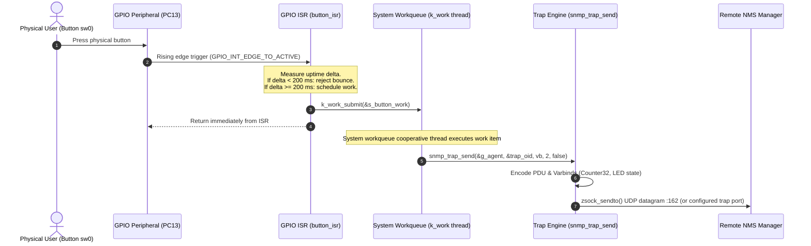
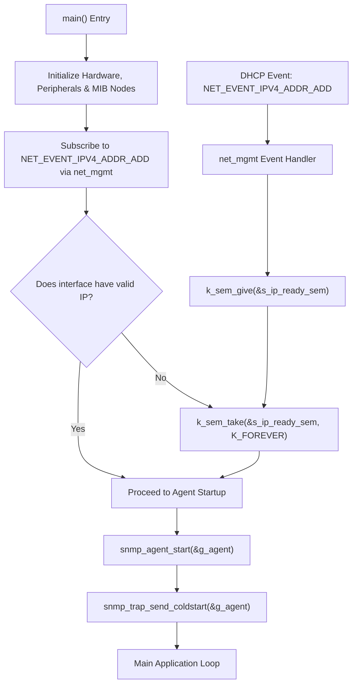

# Hardware and Network Stack Integration

This document details how to integrate the SNMP agent with embedded hardware peripherals and the Zephyr RTOS networking stack, adhering to strict real-time determinism and concurrency best practices.

---

## 1. Hardware Abstraction via Devicetree

Zephyr decouples application logic from board-level pin routing using Devicetree (DTS). On standard development platforms such as the **NUCLEO-H743ZI**, user peripherals are exposed through standardized canonical aliases:
- `led0`: Green user LED (port PB0).
- `sw0`: Blue user push button (port PC13).

```c
#include <zephyr/drivers/gpio.h>

/* Compile-time static retrieval of hardware specifications */
#if DT_NODE_EXISTS(DT_ALIAS(led0))
static const struct gpio_dt_spec s_led = GPIO_DT_SPEC_GET(DT_ALIAS(led0), gpios);
#endif

#if DT_NODE_EXISTS(DT_ALIAS(sw0))
static const struct gpio_dt_spec s_btn = GPIO_DT_SPEC_GET(DT_ALIAS(sw0), gpios);
#endif
```

---

## 2. Actuator Control and Two-Phase Commit (2PC) SET

Actuators (such as LEDs, solid-state relays, and motor drivers) are configured as GPIO outputs. When controlled via SNMP SET, they can be driven through either simple `set_cb` handlers or atomic 2PC `set_tx_cb` handlers:

```c
int app_led_init(void)
{
    if (!gpio_is_ready_dt(&s_led)) {
        return -ENODEV;
    }
    return gpio_pin_configure_dt(&s_led, GPIO_OUTPUT_INACTIVE);
}

void app_led_set_state(int state)
{
    gpio_pin_set_dt(&s_led, state ? 1 : 0);
}

int app_led_get_state(void)
{
    return gpio_pin_get_dt(&s_led);
}

/* Two-Phase Commit (2PC) SET handler for safe hardware actuation */
int led_set_tx_cb(struct snmp_agent *agent, struct snmp_mib_node *node,
                  const struct snmp_varbind *vb, enum snmp_set_action action,
                  void **tx_ctx)
{
    ARG_UNUSED(agent);
    ARG_UNUSED(node);
    ARG_UNUSED(tx_ctx);

    switch (action) {
    case SNMP_SET_RESERVE:
        if (vb->type != ASN1_TAG_INTEGER) {
            return SNMP_ERR_WRONG_TYPE;
        }
        if (vb->val.int_val != 0 && vb->val.int_val != 1) {
            return SNMP_ERR_BAD_VALUE;
        }
        return SNMP_ERR_NO_ERROR;

    case SNMP_SET_COMMIT:
        app_led_set_state(vb->val.int_val);
        return SNMP_ERR_NO_ERROR;

    case SNMP_SET_UNDO:
        /* Restore prior known state if multi-varbind commit fails */
        app_led_set_state(!vb->val.int_val);
        return SNMP_ERR_NO_ERROR;

    case SNMP_SET_CLEANUP:
        return SNMP_ERR_NO_ERROR;

    default:
        return SNMP_ERR_GEN_ERR;
    }
}
```

---

## 3. Safe Interrupt Handling and Trap Dispatch

> [!CAUTION]
> **Critical Real-Time Rule**: **NEVER** invoke `snmp_trap_send()`, `snmp_agent_start()`, or UDP socket functions from an Interrupt Service Routine (ISR). 
> Network operations require buffer allocation (`net_buf`), socket descriptor locking, and potential context switching—all strictly prohibited within interrupt context (`k_is_in_isr()`).

### Recommended Pattern: ISR -> Software Debounce -> Workqueue -> Trap Dispatch



### C Implementation (`samples/snmp_agent/src/app_button.c`)

```c
static void button_work_handler(struct k_work *work);
static K_WORK_DEFINE(s_button_work, button_work_handler);
static int64_t s_last_press_time = 0;
static uint32_t s_button_counter = 0;
extern struct snmp_agent g_agent;

/* 1. ISR Context: Fast and non-blocking */
static void button_isr(const struct device *dev, struct gpio_callback *cb, uint32_t pins)
{
    ARG_UNUSED(dev);
    ARG_UNUSED(cb);
    ARG_UNUSED(pins);

    int64_t now = k_uptime_get();
    /* Software debounce filter (200 ms window) */
    if (now - s_last_press_time > 200) {
        s_last_press_time = now;
        k_work_submit(&s_button_work);
    }
}

/* 2. Workqueue Thread Context: Safe for network socket operations */
static void button_work_handler(struct k_work *work)
{
    ARG_UNUSED(work);
    s_button_counter++;

    /* Assemble custom event notification trap */
    struct snmp_oid trap_oid = {
        .len = 9,
        .ids = {1, 3, 6, 1, 4, 1, 54321, 1, 2, 1}
    };
    struct snmp_varbind vb[2];

    /* Varbind 1: Button press count */
    vb[0].oid.len = 11;
    memcpy(vb[0].oid.ids, (uint32_t[]){1, 3, 6, 1, 4, 1, 54321, 1, 1, 3, 0}, 11 * sizeof(uint32_t));
    vb[0].type = SNMP_TAG_COUNTER32;
    vb[0].val.uint_val = s_button_counter;

    /* Varbind 2: Current LED state */
    vb[1].oid.len = 11;
    memcpy(vb[1].oid.ids, (uint32_t[]){1, 3, 6, 1, 4, 1, 54321, 1, 1, 2, 0}, 11 * sizeof(uint32_t));
    vb[1].type = ASN1_TAG_INTEGER;
    vb[1].val.int_val = app_led_get_state();

    /* Dispatch trap using instance handle */
    snmp_trap_send(&g_agent, &trap_oid, vb, 2, false);
}
```

---

## 4. Network Stack Management and Asynchronous DHCPv4 Synchronization

In embedded systems with dynamic IP addressing, the SNMP agent must not assume that the network interface is bound and ready immediately at boot.

### Semaphore Synchronization Flow



### Recommended `prj.conf` Network Configuration

```ini
# Zephyr Networking Subsystem
CONFIG_NETWORKING=y
CONFIG_NET_UDP=y
CONFIG_NET_SOCKETS=y
CONFIG_NET_SOCKETS_SERVICE=y
CONFIG_NET_IPV4=y

# DHCPv4 Client with Static IP Fallback
CONFIG_NET_DHCPV4=y
CONFIG_NET_CONFIG_SETTINGS=y
CONFIG_NET_CONFIG_NEED_IPV4=y
CONFIG_NET_CONFIG_MY_IPV4_ADDR="192.0.2.1"
CONFIG_NET_CONFIG_MY_IPV4_NETMASK="255.255.255.0"
CONFIG_NET_CONFIG_INIT_TIMEOUT=0

# Thread Stack Sizing (Prevents Fatal Error 2 / Stack Overflow)
CONFIG_MAIN_STACK_SIZE=4096
CONFIG_SYSTEM_WORKQUEUE_STACK_SIZE=4096
CONFIG_NET_MGMT_EVENT_STACK_SIZE=2048

# Immediate Logging Mode (Prevents String Invalidation Across Threads)
CONFIG_LOG=y
CONFIG_LOG_MODE_IMMEDIATE=y
```

