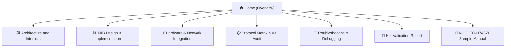

# Zephyr SNMP Wiki

Welcome to the official documentation and wiki for the **Zephyr SNMP Agent** (`zephyr-snmp`) module. This project provides an embedded SNMP agent implementation (v1, v2c, and v3) designed specifically for **Zephyr RTOS**, featuring:

- **Zero Dynamic Allocation (`malloc` = 0)**: Engineered for mission-critical microcontroller environments where heap fragmentation is unacceptable.
- **Native Zephyr Integration**: Leverages `net_socket_service`, Devicetree, GPIO APIs, Workqueues, and the standard Zephyr Logging subsystem.
- **Standard and Enterprise MIB Support**: Built-in MIB-II (System, SNMP, and Interfaces groups) and modular registration of private enterprise OIDs (scalars and tables).
- **Autonomous Notifications**: Dispatch of Traps and Informs (v1, v2c, and v3) triggered by physical hardware interrupts or software events.
- **Instance-Explicit Concurrency**: Re-entrant multi-agent architecture with independent agent structures (`struct snmp_agent`), mutual-exclusion locks, and bounded scratch memory.
- **Declarative Configuration**: Granular control via Zephyr's Kconfig system and `menuconfig`.

---

## 📚 Wiki Navigation Map



1. [**Architecture and Internals**](Architecture-and-Internals.md)
   - Architectural layers: Socket Service, ASN.1 BER Codec, PDU Dispatcher, and MIB Tree Engine.
   - Instance-explicit model (`struct snmp_agent`), scratch union memory optimization, and thread safety.
   - Autonomous trap engine and asynchronous notification pipeline.

2. [**MIB Design and Implementation**](MIB-Design-and-Implementation.md)
   - Enterprise MIB definition following SMIv2 standards.
   - Scalar registration with instance-explicit callbacks (`snmp_mib_register`, `snmp_mib_register_nodes`).
   - Dynamic multi-column tables with `struct snmp_table_index` and row chaining (`snmp_mib_table_add_row`).
   - RFC 3416 4-phase Two-Phase Commit (`SNMP_SET_RESERVE`, `SNMP_SET_COMMIT`, `SNMP_SET_UNDO`, `SNMP_SET_CLEANUP`).
   - The `user_data` pointer isolation invariant.

3. [**Hardware and Network Integration**](Hardware-and-Network-Integration.md)
   - Devicetree peripheral binding (`led0`, `sw0`).
   - Real-time interrupt offloading: ISR -> software debounce -> workqueue delegation -> `snmp_trap_send()`.
   - Zephyr network stack integration: DHCPv4 synchronization, link carrier monitoring, and socket polling.

4. [**Protocol Matrix and Interoperability Audit**](SNMP-Version-Matrix-and-Interoperability.md)
   - Comprehensive feature comparison across SNMPv1, SNMPv2c, and SNMPv3.
   - RFC 3414 compliance: streaming password-to-key ($1\,\text{MB}$) and localized key generation ($K_u \parallel \text{engine\_id} \parallel K_u$).
   - Interoperability recipes for Net-SNMP CLI, iReasoning MIB Browser, and Wireshark dissection.

5. [**Troubleshooting and Debugging**](Troubleshooting-and-Debugging.md)
   - Diagnosing UDP timeouts, silent drops for invalid communities, and carrier link-down states.
   - Resolving stack overflows (`CONFIG_NET_MGMT_EVENT_STACK_SIZE`), deferred logging faults, and ZVFS poll budgets.
   - Trap reception on unprivileged host ports.

6. [**Hardware-in-the-Loop (HIL) Validation**](snmp-hil-validation.md)
   - Complete 33-test physical validation record on STM32H7 hardware across SNMPv1, SNMPv2c, and SNMPv3 (authNoPriv / authPriv).

7. [**NUCLEO-H743ZI Reference Sample**](../../samples/snmp_agent/README.md)
   - Step-by-step build, flash, interactive UART console commands, and host verification recipes.

8. [**SNMPv3 Validation Sample**](../../samples/snmp_agent_v3/README.md)
   - authPriv/authNoPriv users, VACM boundaries, engine discovery Reports and v3 notifications with public test-only credentials.

---

## ⚡ Quick Start

### 1. Enable in `prj.conf`

```ini
CONFIG_NETWORKING=y
CONFIG_NET_UDP=y
CONFIG_NET_SOCKETS=y
CONFIG_NET_SOCKETS_SERVICE=y

CONFIG_SNMP_AGENT=y
CONFIG_SNMP_VERSION_1=y
CONFIG_SNMP_VERSION_2C=y
CONFIG_SNMP_TRAP_ENABLED=y
CONFIG_SNMP_AGENT_PORT=161
CONFIG_SNMP_COMMUNITY_READ="public"
CONFIG_SNMP_COMMUNITY_WRITE="private"
```

### 2. Register a Scalar Node in C

```c
#include <snmp/snmp.h>
#include <snmp/snmp_core.h>
#include <snmp/snmp_mib.h>

static struct snmp_agent g_agent;
static int32_t s_device_temperature = 25;

static int get_temp(struct snmp_agent *agent, const struct snmp_mib_node *node,
                    struct snmp_varbind *vb)
{
    ARG_UNUSED(agent);
    ARG_UNUSED(node);
    vb->type = ASN1_TAG_INTEGER;
    vb->val.int_val = s_device_temperature;
    return 0;
}

static int set_temp(struct snmp_agent *agent, struct snmp_mib_node *node,
                    const struct snmp_varbind *vb)
{
    ARG_UNUSED(agent);
    ARG_UNUSED(node);
    if (vb->type != ASN1_TAG_INTEGER) {
        return SNMP_ERR_BAD_VALUE;
    }
    s_device_temperature = vb->val.int_val;
    return 0;
}

void app_snmp_init(void)
{
    static const struct snmp_mib_node temp_node = {
        .oid = {.len = 9, .ids = {1, 3, 6, 1, 4, 1, 54321, 1, 0}},
        .type = ASN1_TAG_INTEGER,
        .get_cb = get_temp,
        .set_cb = set_temp,
    };

    static const struct snmp_agent_cfg cfg = {
        .port = 161,
        .community_read = "public",
        .community_write = "private",
    };

    snmp_agent_init(&g_agent, &cfg);
    snmp_mib_register(&g_agent, &temp_node);
    snmp_agent_start(&g_agent);
}
```

> [!IMPORTANT]
> **Callback & User Data Invariant**: All MIB callback functions take `struct snmp_agent *agent` as their first parameter. The `user_data` pointer on `struct snmp_mib_node` or `struct snmp_table_row` must reference only application-owned data or static constants—**never** the `struct snmp_agent` instance or any internal field.

### 3. Query from Management Host

```bash
# Read temperature
snmpget -v2c -c public <TARGET_IP> 1.3.6.1.4.1.54321.1.0

# Update temperature
snmpset -v2c -c private <TARGET_IP> 1.3.6.1.4.1.54321.1.0 i 30
```
