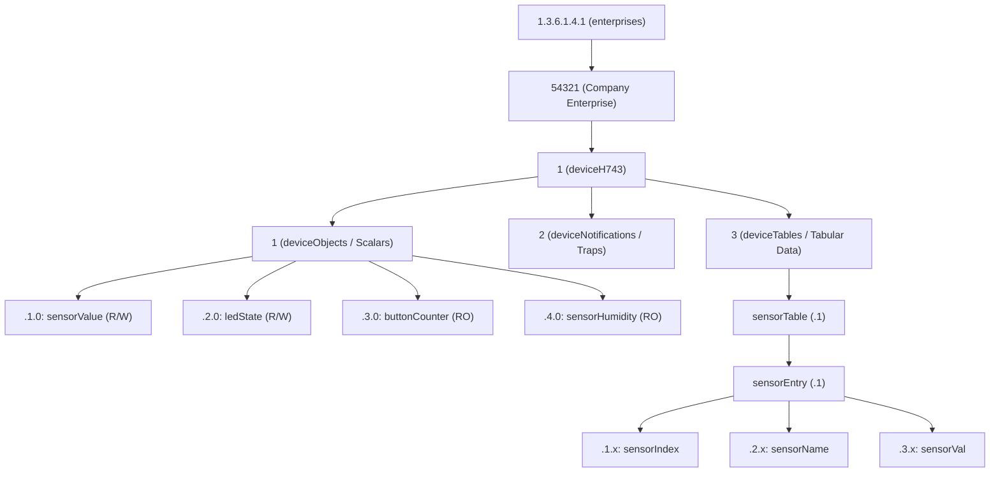

# MIB Design and Implementation in Zephyr

This document is a comprehensive guide to designing, registering, and managing scalar variables, dynamic tables, and transactional SET operations in the Zephyr RTOS SNMP agent.

---

## 1. OID Hierarchy and Allocation

All private enterprise MIBs are anchored under the IANA enterprise tree:
`iso.org.dod.internet.private.enterprises` (`1.3.6.1.4.1.<ENTERPRISE_ID>`).

### Recommended Branch Hierarchy



> [!IMPORTANT]
> **Scalar Instance Suffix (`.0`)**: Every scalar object in SNMP **must** terminate with the sub-identifier `.0` representing its singular instance. Omitting `.0` in requests causes management tools to report `noSuchInstance` or `noSuchName`.

---

## 2. Implementing Scalar Variables

All callback functions take `struct snmp_agent *agent` as their first parameter. Registration requires the target agent instance handle (`snmp_mib_register(&agent, &node)` or `snmp_mib_register_nodes(&agent, nodes, count)`).

### A. Read-Only Scalar (`Counter32`, `OCTET STRING`)

```c
#include <snmp/snmp.h>
#include <snmp/snmp_core.h>
#include <snmp/snmp_mib.h>
#include <string.h>

static uint32_t s_packet_count = 1420;
static const char s_model_name[] = "Zephyr-IoT-Gateway-v2";

/* Read callback for Counter32 */
static int get_counter_cb(struct snmp_agent *agent, const struct snmp_mib_node *node,
                          struct snmp_varbind *vb)
{
    ARG_UNUSED(agent);
    ARG_UNUSED(node);
    vb->type = SNMP_TAG_COUNTER32;
    vb->val.uint_val = s_packet_count;
    return 0;
}

/* Read callback for OCTET STRING */
static int get_model_cb(struct snmp_agent *agent, const struct snmp_mib_node *node,
                        struct snmp_varbind *vb)
{
    ARG_UNUSED(agent);
    ARG_UNUSED(node);
    vb->type = ASN1_TAG_OCTET_STRING;
    size_t len = strlen(s_model_name);
    if (len > sizeof(vb->val.octet_str.data)) {
        len = sizeof(vb->val.octet_str.data);
    }
    memcpy(vb->val.octet_str.data, s_model_name, len);
    vb->val.octet_str.len = (uint16_t)len;
    return 0;
}

/*
 * Note: Read-Only access is established by setting .set_cb = NULL and .set_tx_cb = NULL.
 * The core automatically rejects SET attempts with SNMP_ERR_NOT_WRITABLE.
 */
void register_read_only_scalars(struct snmp_agent *agent)
{
    static const struct snmp_mib_node nodes[] = {
        /* 1.3.6.1.4.1.54321.1.1.3.0 */
        {
            .oid = {.len = 11, .ids = {1, 3, 6, 1, 4, 1, 54321, 1, 1, 3, 0}},
            .type = SNMP_TAG_COUNTER32,
            .get_cb = get_counter_cb,
            .set_cb = NULL,
            .set_tx_cb = NULL,
        },
        /* 1.3.6.1.4.1.54321.1.1.5.0 */
        {
            .oid = {.len = 11, .ids = {1, 3, 6, 1, 4, 1, 54321, 1, 1, 5, 0}},
            .type = ASN1_TAG_OCTET_STRING,
            .get_cb = get_model_cb,
            .set_cb = NULL,
            .set_tx_cb = NULL,
        },
    };

    snmp_mib_register_nodes(agent, nodes, ARRAY_SIZE(nodes));
}
```

### B. Read-Write Scalar with Bounds Validation (R/W)

For standard single-variable SET requests, provide `set_cb`:
1. Validate that the ASN.1 type matches expectations (`SNMP_ERR_WRONG_TYPE`).
2. Validate that the value is within allowable ranges (`SNMP_ERR_BAD_VALUE`).
3. Commit the change to hardware or application state.

```c
static int32_t s_fan_speed_percent = 50; /* Valid range: 0 to 100 */

static int get_fan_speed(struct snmp_agent *agent, const struct snmp_mib_node *node,
                         struct snmp_varbind *vb)
{
    ARG_UNUSED(agent);
    ARG_UNUSED(node);
    vb->type = ASN1_TAG_INTEGER;
    vb->val.int_val = s_fan_speed_percent;
    return 0;
}

static int set_fan_speed(struct snmp_agent *agent, struct snmp_mib_node *node,
                         const struct snmp_varbind *vb)
{
    ARG_UNUSED(agent);
    ARG_UNUSED(node);

    if (vb->type != ASN1_TAG_INTEGER) {
        return SNMP_ERR_WRONG_TYPE;
    }
    if (vb->val.int_val < 0 || vb->val.int_val > 100) {
        return SNMP_ERR_BAD_VALUE;
    }

    s_fan_speed_percent = vb->val.int_val;
    return 0;
}

void register_rw_scalar(struct snmp_agent *agent)
{
    static const struct snmp_mib_node node_fan = {
        .oid = {.len = 11, .ids = {1, 3, 6, 1, 4, 1, 54321, 1, 1, 7, 0}},
        .type = ASN1_TAG_INTEGER,
        .get_cb = get_fan_speed,
        .set_cb = set_fan_speed,
    };
    snmp_mib_register(agent, &node_fan);
}
```

---

## 3. Two-Phase Commit (2PC) SET Transactions

When multiple variables are modified in a single SNMP PDU (or when peripheral actuation must ensure all-or-nothing atomicity), implement `set_tx_cb` (`snmp_mib_set_tx_cb_t`) conforming to **RFC 3416 §4.2.5**.

### 2PC Action Phases (`enum snmp_set_action`)

1. `SNMP_SET_RESERVE`: Phase 1 validation. Check value ranges, allocate hardware locks, or verify peripheral readiness. If any varbind fails here, the entire request aborts with no side effects.
2. `SNMP_SET_COMMIT`: Phase 2 application. Invoked only when all varbinds in the PDU succeeded in the reserve phase. Actuate hardware or update operational registers.
3. `SNMP_SET_UNDO`: Phase 3 rollback. If any varbind fails during commit, all previously committed items are rolled back using backed-up values.
4. `SNMP_SET_CLEANUP`: Phase 4 finalization. Always called at the end to free temporary contexts, release bus locks, or clean up resources.

### 2PC Callback Example

```c
static int32_t s_voltage_limit = 3300; /* mV */

static int set_voltage_tx(struct snmp_agent *agent, struct snmp_mib_node *node,
                          const struct snmp_varbind *vb, enum snmp_set_action action,
                          void **tx_ctx)
{
    ARG_UNUSED(agent);
    ARG_UNUSED(node);
    ARG_UNUSED(tx_ctx);

    switch (action) {
    case SNMP_SET_RESERVE:
        if (vb->type != ASN1_TAG_INTEGER) {
            return SNMP_ERR_WRONG_TYPE;
        }
        if (vb->val.int_val < 1800 || vb->val.int_val > 5000) {
            return SNMP_ERR_BAD_VALUE;
        }
        return SNMP_ERR_NO_ERROR;

    case SNMP_SET_COMMIT:
        s_voltage_limit = vb->val.int_val;
        return SNMP_ERR_NO_ERROR;

    case SNMP_SET_UNDO:
        /* Rollback if another variable in the PDU failed commit */
        return SNMP_ERR_NO_ERROR;

    case SNMP_SET_CLEANUP:
        return SNMP_ERR_NO_ERROR;

    default:
        return SNMP_ERR_GEN_ERR;
    }
}
```

---

## 4. Dynamic Multi-Column Tables

SNMP tables represent multidimensional or multi-row tabular collections (such as network interfaces, sensor channels, or power relays).

### Table OID Anatomy
- **Table OID**: `.1.3.6.1.4.1.54321.1.3` (`sensorTable`)
- **Entry OID**: `.1.3.6.1.4.1.54321.1.3.1` (`sensorEntry`)
- **Column OID**: `.1.3.6.1.4.1.54321.1.3.1.<COL>` (`1=index`, `2=name`, `3=val`)
- **Instance OID**: `.1.3.6.1.4.1.54321.1.3.1.<COL>.<INDEX_SUFFIX>`

### Table Implementation with Row Management

Zephyr SNMP supports dynamic row chaining and unlinking via `snmp_mib_table_add_row()` and `snmp_mib_table_remove_row()`. Row mutations are automatically serialized with `agent->lock`.

```c
/* Static row structures owned by application */
static struct snmp_table_row s_row1 = {.index = 1};
static struct snmp_table_row s_row2 = {.index = 2};
static struct snmp_table_row s_row3 = {.index = 3};

/* Per-column read callback */
static int col_index_get(struct snmp_agent *agent, const struct snmp_table_row *row,
                         uint8_t col, struct snmp_varbind *vb)
{
    ARG_UNUSED(agent);
    ARG_UNUSED(col);
    vb->type = ASN1_TAG_INTEGER;
    vb->val.int_val = (int32_t)row->index;
    return 0;
}

static int col_name_get(struct snmp_agent *agent, const struct snmp_table_row *row,
                        uint8_t col, struct snmp_varbind *vb)
{
    ARG_UNUSED(agent);
    ARG_UNUSED(col);
    static const char *names[] = {"Channel 1 (CPU)", "Channel 2 (Ambient)", "Channel 3 (Power)"};
    const char *name = (row->index >= 1 && row->index <= 3) ? names[row->index - 1] : "Unknown";

    vb->type = ASN1_TAG_OCTET_STRING;
    size_t len = strlen(name);
    memcpy(vb->val.octet_str.data, name, len);
    vb->val.octet_str.len = (uint16_t)len;
    return 0;
}

static int col_val_get(struct snmp_agent *agent, const struct snmp_table_row *row,
                       uint8_t col, struct snmp_varbind *vb)
{
    ARG_UNUSED(agent);
    ARG_UNUSED(col);
    static const int32_t readings[] = {32, 60, 3300};
    vb->type = ASN1_TAG_INTEGER;
    vb->val.int_val = (row->index >= 1 && row->index <= 3) ? readings[row->index - 1] : 0;
    return 0;
}

/* Table configuration */
static const uint8_t s_col_ids[] = {1, 2, 3};
static const uint8_t s_col_types[] = {ASN1_TAG_INTEGER, ASN1_TAG_OCTET_STRING, ASN1_TAG_INTEGER};
static snmp_table_get_cb_t s_get_cbs[] = {col_index_get, col_name_get, col_val_get};

static struct snmp_mib_table s_sensor_table = {
    .table_oid = {
        .len = 10,
        .ids = {1, 3, 6, 1, 4, 1, 54321, 1, 3, 1} /* sensorEntry OID */
    },
    .column_cnt = 3,
    .column_subids = s_col_ids,
    .column_types = s_col_types,
    .get_cbs = s_get_cbs,
    .set_cbs = NULL,
    .rows = NULL, /* Rows are linked dynamically below */
};

void register_sensor_table(struct snmp_agent *agent)
{
    snmp_mib_register_table(agent, &s_sensor_table);

    /* Dynamically add rows into the table */
    snmp_mib_table_add_row(agent, &s_sensor_table, &s_row1);
    snmp_mib_table_add_row(agent, &s_sensor_table, &s_row2);
    snmp_mib_table_add_row(agent, &s_sensor_table, &s_row3);
}

void unregister_sensor_row(struct snmp_agent *agent, uint32_t row_index)
{
    /* Safe dynamic removal by index */
    snmp_mib_table_remove_row(agent, &s_sensor_table, row_index);
}
```

---

## 5. Architectural Invariants and Safety Rules

> [!CAUTION]
> **1. The `user_data` Invariant**:
> `node->user_data` and `row->user_data` may point only to application-owned state (e.g. sensor descriptors, device structures) or compile-time constants. **Never point `user_data` at a `struct snmp_agent` or any field within it.** Cross-instance aliasing can corrupt counters and violate instance isolation.

> [!WARNING]
> **2. Locking and Context**:
> MIB callbacks are executed with `agent->lock` held by the SNMP core worker. Callbacks **must never** attempt to re-acquire `agent->lock` or invoke blocking agent lifecycle functions (`snmp_agent_stop`, `snmp_agent_deinit`), as this will cause deadlock. Keep callback execution non-blocking and fast.

---

## 6. Host Validation with Net-SNMP

Load the enterprise MIB file using the `-m` flag:

```bash
# Read scalar sensorValue.0
snmpget -v2c -c public -m ./NUCLEO-H743-MIB.txt <TARGET_IP> sensorValue.0

# Write scalar sensorValue.0
snmpset -v2c -c private -m ./NUCLEO-H743-MIB.txt <TARGET_IP> sensorValue.0 i 42

# Tabular walk of the entire sensorTable
snmptable -v2c -c public -m ./NUCLEO-H743-MIB.txt <TARGET_IP> sensorTable
```

